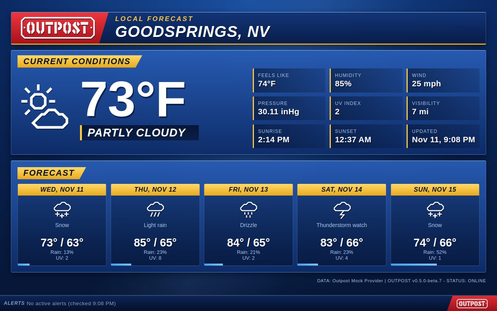
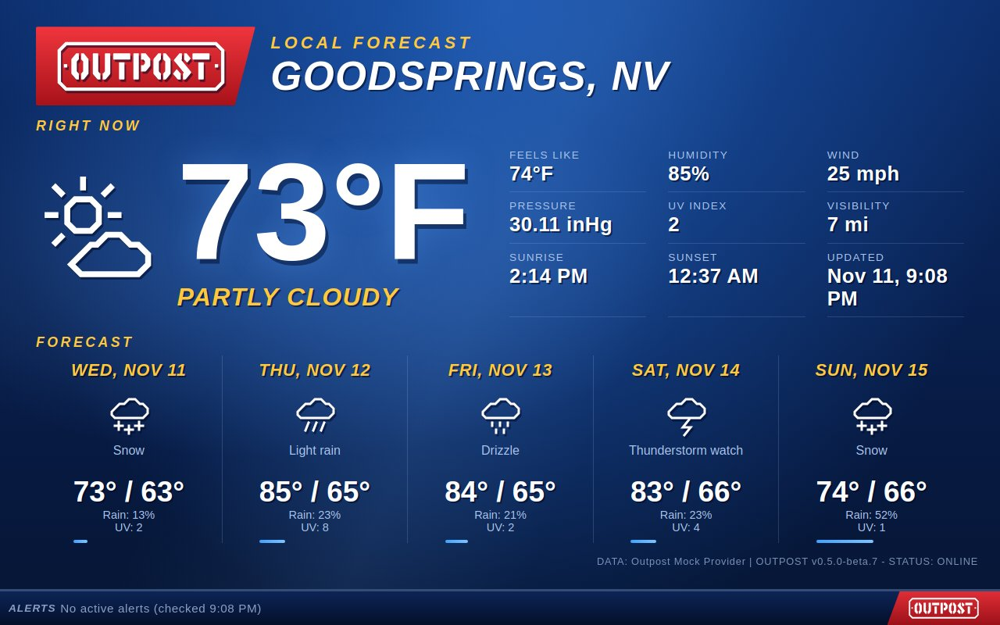
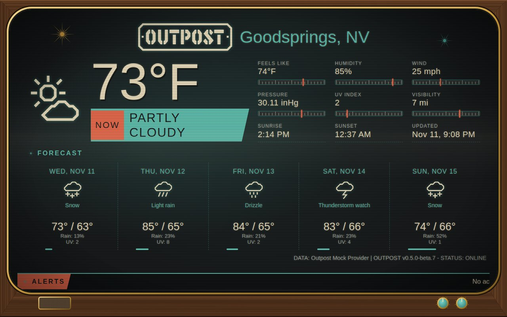
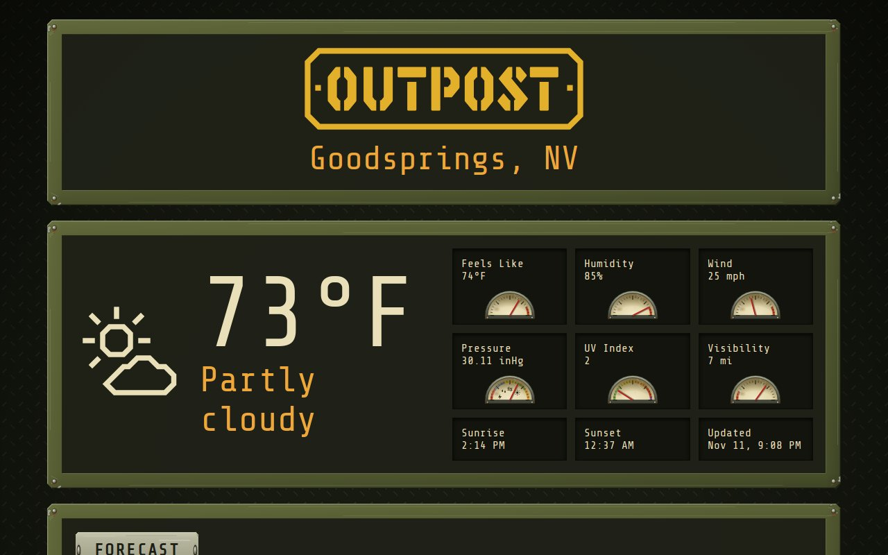
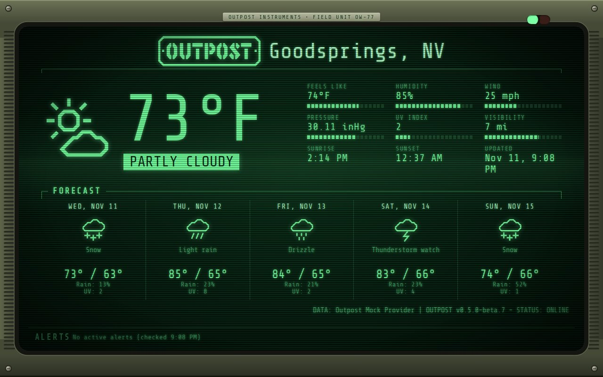

# Outpost community themes

Themes for [Outpost](https://github.com/maxtrax04/outpost), the self-hosted dashboard for wall displays and
phones, made by people who use it. Each theme is in a folder named after the person who made it, and is
called `username/theme`.

## Using a theme

**Let Outpost download it.** List the themes you want in your Outpost settings (`.env`):

```
OUTPOST_COMMUNITY_THEMES=maxtrax04/weather-desk,maxtrax04/wristcomp
```

Outpost downloads them once each time the container starts and keeps them, so they keep working with no
internet. Restart the container to get updates. Then pick one with the theme button, or make it the
default with `OUTPOST_THEME=maxtrax04/weather-desk`. A theme that builds on another theme by the same person
brings that one along.

**Or use them offline.** Clone this repository and mount it as Outpost's custom themes folder:

```yaml
    volumes:
      - ./data:/data
      - ./outpost-themes:/config/themes:ro
```

Every theme then shows in the theme button, under the same names.

Community themes need Outpost 0.5.0 or later. See "Community themes" in the
[Outpost README](https://github.com/maxtrax04/outpost#community-themes).

## Available themes

| Creator | Theme | Example | What it is |
| :---: | :--- | :---: | :--- |
| maxtrax04 | [`maxtrax04/weather-desk`](maxtrax04/weather-desk/) |  | A local newscast's forecast segment, with alerts on a news ticker |
| maxtrax04 | [`maxtrax04/weather-desk-live`](maxtrax04/weather-desk-live/) |  | Weather Desk as one on-air picture, without boxes |
| maxtrax04 | [`maxtrax04/atomic-broadcast-live`](maxtrax04/atomic-broadcast-live/) |  | The built-in Atomic Broadcast as one on-air picture |
| maxtrax04 | [`maxtrax04/field-station-weathered`](maxtrax04/field-station-weathered/) |  | The built-in Field Station after years outdoors |
| maxtrax04 | [`maxtrax04/wristcomp`](maxtrax04/wristcomp/) |  | A rugged wrist-mounted field computer with a green phosphor screen |

## Adding your theme

See [CONTRIBUTING.md](CONTRIBUTING.md). In short: fork this repository, put your theme in
`<your-username>/<theme-name>/` with a README and a screenshot, add a row to the table above, and open a pull
request. Automatic checks run on every pull request, and each theme is reviewed before it's added.

## License

Themes here are shared under the [MIT License](LICENSE), unless a theme's folder says otherwise for a font it
includes.
