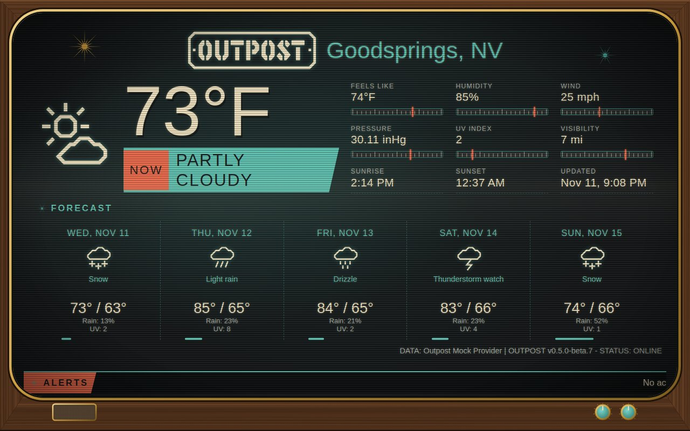

# Atomic Broadcast Live



Outpost's built-in **Atomic Broadcast** theme (a 1950s television set) as one on-air picture: no boxes around the panels, larger readings over full-width tuning scales, and the forecast days divided by dashed teal lines. The cabinet, the test card, and the alerts news crawl are the same.

## Use it

```
OUTPOST_COMMUNITY_THEMES=maxtrax04/atomic-broadcast-live
```

Then pick **Atomic Broadcast Live** with the theme button, or set `OUTPOST_THEME=maxtrax04/atomic-broadcast-live`. It builds on the built-in `atomic-broadcast` theme. Needs Outpost 0.5.0-beta.8 or later.
