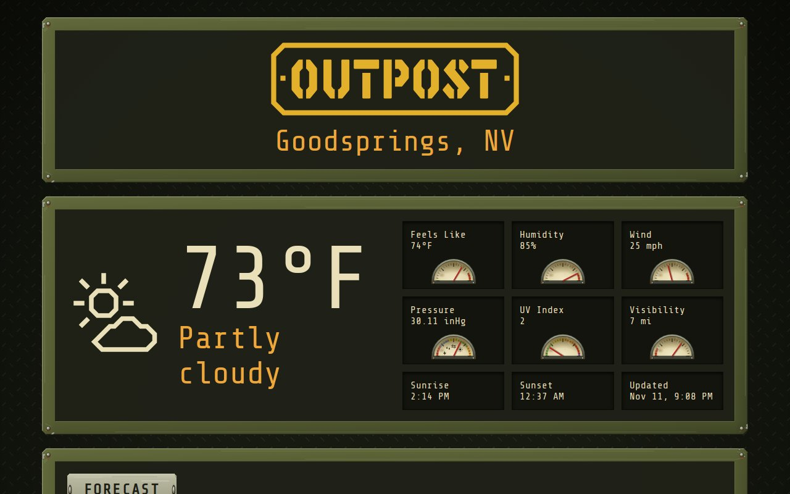

# Field Station Weathered



Outpost's built-in **Field Station** theme (a riveted steel instrument panel) after years outdoors: chipped olive paint and scratches on the bezels, a worn stamped plate for each title, grime on the dial faces, and faded hazard stripes.

## Use it

```
OUTPOST_COMMUNITY_THEMES=maxtrax04/field-station-weathered
```

Then pick **Field Station Weathered** with the theme button, or set `OUTPOST_THEME=maxtrax04/field-station-weathered`. It builds on the built-in `field-station` theme. Needs Outpost 0.5.0 or later.
