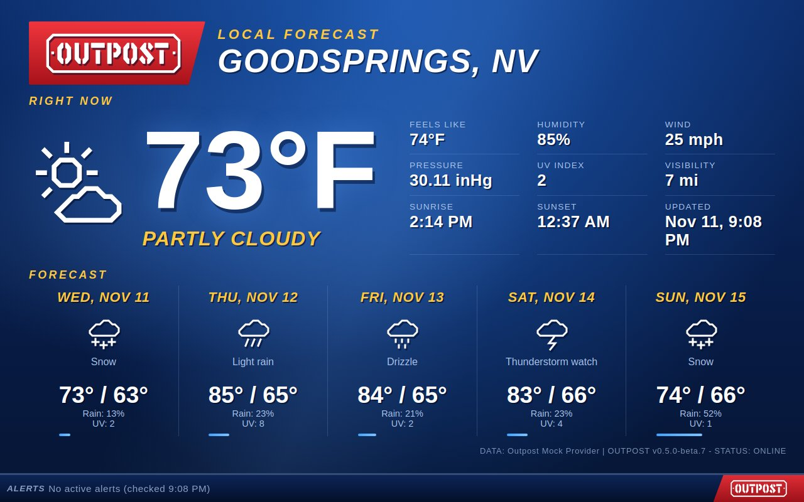

# Weather Desk Live



[Weather Desk](../weather-desk/) as one on-air picture: no boxes around the panels, a large temperature, the readings as an underlined list, and the forecast days divided by thin lines. The news ticker for alerts, the quiet line when there are none, and the "Please stand by" slate are the same.

## Use it

```
OUTPOST_COMMUNITY_THEMES=maxtrax04/weather-desk-live
```

Then pick **Weather Desk Live** with the theme button, or set `OUTPOST_THEME=maxtrax04/weather-desk-live`. It builds on `maxtrax04/weather-desk`, which Outpost downloads along with it. Needs Outpost 0.5.0-beta.8 or later.
