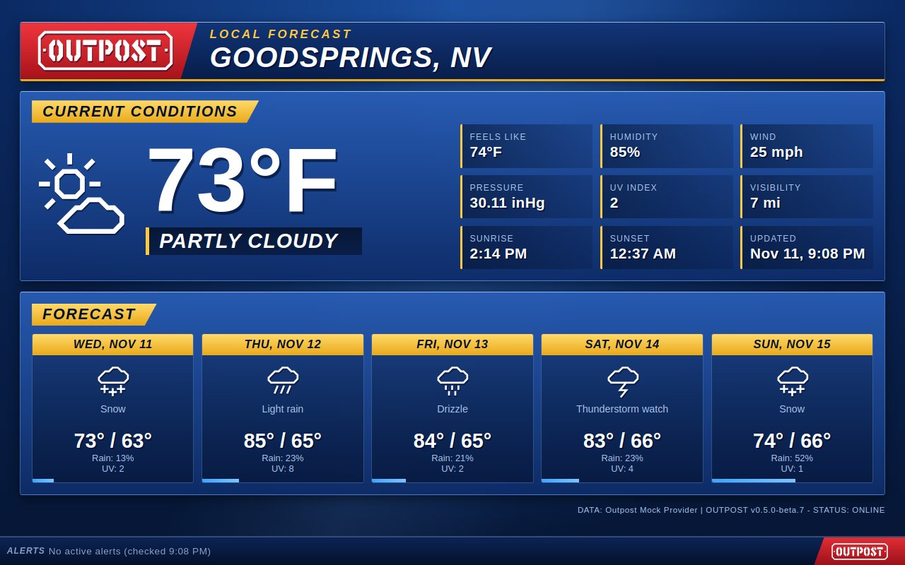

# Weather Desk



The forecast segment of a local evening newscast. A blue studio background with gold title tabs, the Outpost wordmark as the station logo, the current conditions as a lower third, and forecast cards with a rain bar.

- **Alerts** run along a news ticker at the bottom of the screen, with the logo at its end. With no alerts, the same bar holds a quiet, still line, whether `OUTPOST_ALERTS_ALWAYS_SHOW` is `true` or `false`.
- A "Please stand by" slate shows while the weather loads, or when it can't be read.
- Fits the whole dashboard on the screen, growing on big screens.
- **Reduced effects:** the ticker stands still and wraps.

## Use it

```
OUTPOST_COMMUNITY_THEMES=maxtrax04/weather-desk
```

Then pick **Weather Desk** with the theme button, or set `OUTPOST_THEME=maxtrax04/weather-desk`. Needs Outpost 0.5.0 or later.
