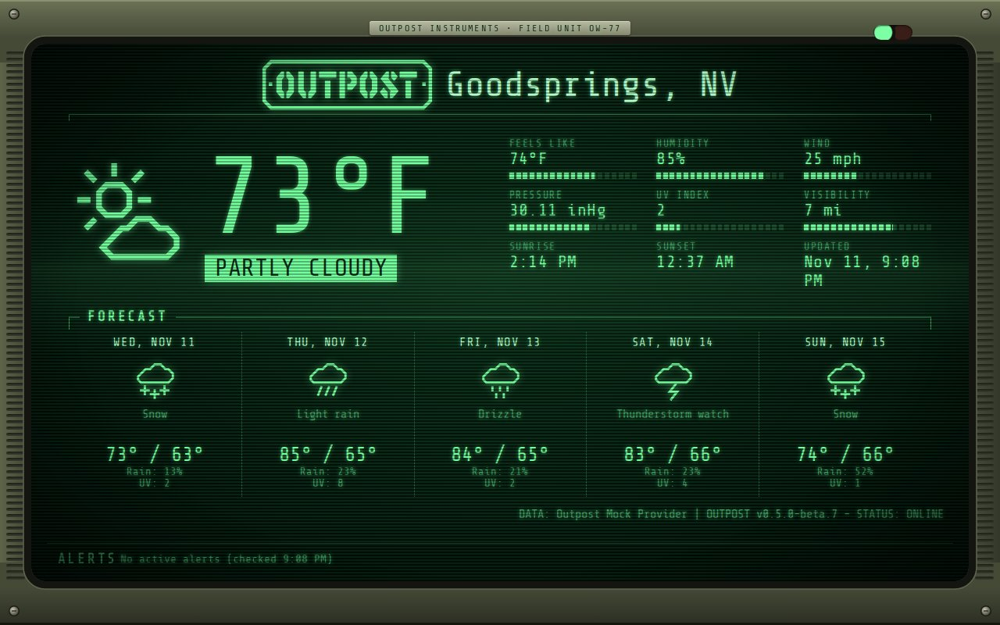

# Wristcomp



A rugged wrist-mounted field computer. The dashboard sits on a green phosphor screen inside an olive metal housing with grip ridges, rivets, and a maker's plate ("Outpost Instruments, Field Unit OW-77").

- Two status lights on the housing: **data** (green when the weather is current, amber when it is old, off with none) and **alert** (blinks red for a severe alert).
- Readings get segmented bar meters, and the condition is shown in inverse video.
- A slow band of light rolls down the screen, over the scanlines.
- A boot screen shows while the weather loads, and "NO SIGNAL" when it can't be read.
- **Alerts** scroll along a ticker at the bottom of the screen.
- Fits the whole dashboard on the screen.
- **Reduced effects:** the band, the blinking, and the ticker stop, and alerts wrap.

## Use it

```
OUTPOST_COMMUNITY_THEMES=maxtrax04/wristcomp
```

Then pick **Wristcomp** with the theme button, or set `OUTPOST_THEME=maxtrax04/wristcomp`. Needs Outpost 0.5.0-beta.8 or later.
